<div align="center">

<br>

# VisionForge

### Optical inspection as a Process Equipment Assembly

**A camera, a robotic arm and a set of vision tasks, delivered as one MTP-conformant module<br>
that any Process Orchestration Layer can discover, command and read over OPC UA.**

<br>

[](LICENSE)
[](https://www.python.org/)
[](https://doc.qt.io/qtforpython-6/)
[](https://github.com/ultralytics/ultralytics)
[](https://github.com/baudm/parseq)
<br>
[](https://www.vdi.de/)
[](https://opcfoundation.org/)
[](https://github.com/p2o-lab/MTPPy)

<br>

[The problem](#-the-problem) · [What it does](#-what-it-does) · [Quick start](#-quick-start) · [How it works](#-how-it-works) · [Inspection tasks](#-the-inspection-tasks) · [MTP services](#-a-true-pea-mtp-services-over-opc-ua) · [Plugin SDK](#-plugin-sdk)

</div>

<br>

<p align="center"></p>

## 🎯 The problem

Process plants are moving from monolithic installations to **modular** ones, assembled from **Process
Equipment Assemblies (PEAs)**: self-contained units that carry their own equipment and their own control
logic, and describe what they can do in a vendor-neutral **Module Type Package (MTP)**, as defined by
VDI/VDE/NAMUR 2658. A plant engineer can procure a dosing unit or a stirred tank as a module and expect it
to work without knowing how it was made.

> [!IMPORTANT]
> **For optical inspection there is nothing to procure.** In the process industry, vision systems are still
> integrated as fixed equipment, engineered once for one measurement. The field has produced a
> *specification* for what a camera module should offer, and a handful of realisations, each built from
> nothing and none complete.

**VisionForge makes optical inspection a module.** It turns a smart camera and a five-axis arm into a PEA
whose inspections are exposed as standard **MTP services over OPC UA**. A Process Orchestration Layer can
start one, set its parameters and read its results exactly as it would any other module in the plant, and
because inspections are plugins, the module grows with the plant instead of being re-engineered for it.

> [!NOTE]
> Developed at the **Chair of Process Control Systems (P2O-Lab), TU Dresden**, and built on the laboratory's
> own open-source library [**MTPPy**](https://github.com/p2o-lab/MTPPy). Its orchestration counterpart is
> [**Orchestrion**](https://github.com/marwendh/Orchestrion), an open Process Orchestration Layer that drives
> VisionForge and any other conformant PEA.

<p align="center"></p>

## ✨ What it does

<table>
<tr>
<td width="33%" align="center" valign="top">
<br>
<h3>🎥</h3>
<b>Drives the camera</b>
<br><br>
<sub>Live 2448 × 2048 frames streamed raw in BayerRG8 — a third of the bytes of RGB — with exposure, gain and white balance changed live.</sub>
<br><br>
</td>
<td width="33%" align="center" valign="top">
<br>
<h3>🦾</h3>
<b>Drives the arm</b>
<br><br>
<sub>The xArm 5 moves manually with a gamepad, or programmatically through the platform's API, which the tasks use to scan and to centre.</sub>
<br><br>
</td>
<td width="33%" align="center" valign="top">
<br>
<h3>🔍</h3>
<b>Runs inspections</b>
<br><br>
<sub>Seven-segment displays, valve states, mobile-module tracking and leak detection, each in its own thread, several at once.</sub>
<br><br>
</td>
</tr>
<tr>
<td width="33%" align="center" valign="top">
<br>
<h3>🧩</h3>
<b>Grows with plugins</b>
<br><br>
<sub>A new inspection is two classes, plus a third to expose it as an MTP service. A bundled runner tests it before it is installed.</sub>
<br><br>
</td>
<td width="33%" align="center" valign="top">
<br>
<h3>🏭</h3>
<b>Is a real PEA</b>
<br><br>
<sub>Every inspection that declares a service becomes an MTP service over OPC UA, with the full 2658 lifecycle and a generated manifest.</sub>
<br><br>
</td>
<td width="33%" align="center" valign="top">
<br>
<h3>📈</h3>
<b>Keeps the history</b>
<br><br>
<sub>Readings and module positions go to InfluxDB as time series, to be followed, queried and exported over time.</sub>
<br><br>
</td>
</tr>
</table>

<p align="center"></p>

## 🚀 Quick start

> [!TIP]
> **You need** Python **3.11**, the camera and the arm on the network, and the camera server running on the
> camera — it starts on boot and publishes on ports `5555` and `5556`. **InfluxDB 2.x** is optional: it only
> stores readings, and every task runs without it.

```bash
# 1 · clone
git clone https://github.com/p2o-lab/VisionForge.git
cd VisionForge

# 2 · install  (the first line fetches the CUDA build of PyTorch; skip it to run on the CPU)
python -m venv .venv && .venv\Scripts\activate          # Linux / macOS:  source .venv/bin/activate
pip install torch==2.10.0 torchvision==0.25.0 --index-url https://download.pytorch.org/whl/cu128
pip install -r requirements.txt

# 3 · run
python main.py
```

The splash screen loads the models and scans `plugins/`, then asks for the equipment addresses:

<div align="center">

| | Default |
|:---|:---|
| 📷&nbsp; **Camera** | `10.6.51.140` |
| 🦾&nbsp; **Arm** | `10.6.51.141` |
| 🔌&nbsp; **OPC UA port** | `48050` |

</div>

The module's OPC UA server then comes up at **`opc.tcp://<host>:48050/`**, ready for
[Orchestrion](https://github.com/marwendh/Orchestrion), UaExpert or any other OPC UA client.

<details>
<summary><b>📦 Model weights</b></summary>

<br>

The trained weights ship with the repository, so there is nothing to download:

```
app/tasks/seven_segment/weights/yolo/best.pt              display detector   54 MB
app/tasks/seven_segment/weights/parseq/parseq_7seg.ckpt   digit reader       95 MB
```

The digit reader is stored without its optimizer and training state: it runs identically, but cannot be
used to resume training.

</details>

<details>
<summary><b>🗄️ InfluxDB set-up</b></summary>

<br>

The connection is set by the `INFLUX_*` constants at the top of `app/tasks/seven_segment/core.py` and
`app/tasks/module_tracker/core.py`. Create the two buckets the tasks write to, spelled exactly as below:

| Bucket | Written by | Content |
|---|---|---|
| `7Segments_Measurments` | Seven-segment reader | one measurement per named display, its reading in the field `value` |
| `Modules_Tracking` | Module tracker | position, heading and distance of every visible module, once per second |

</details>

<p align="center"></p>

## 🧱 The module

<p align="center">
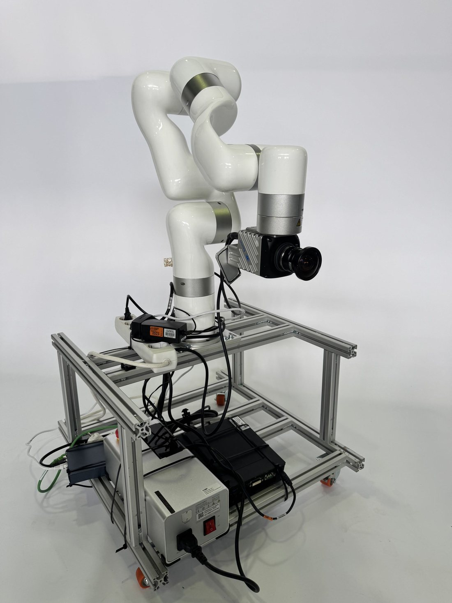
</p>

<div align="center">

| | Component | Model | Role |
|:---:|:---|:---|:---|
| 📷 | **Camera** | Baumer VAX-50C.I.NVX | 5 MP smart camera, **NVIDIA Jetson Xavier NX** on board |
| 🦾 | **Arm** | UFACTORY xArm 5 | Five-axis manipulator, camera on its end effector |
| 🧱 | **Frame** | Aluminium profile on castors | Holds everything, moves between stations |
| 🌐 | **Network** | Router on the frame | Camera and arm on one subnet, over Ethernet |
| 🎮 | **Input** | USB gamepad | Manual control of the arm |

</div>

> [!NOTE]
> **The camera is a computer with a lens.** The camera server runs *on the camera itself* — acquiring frames,
> applying the parameters it is sent and publishing the raw images — which is what makes the module
> self-contained.

<p align="center"></p>

## 🔧 How it works

### Three layers

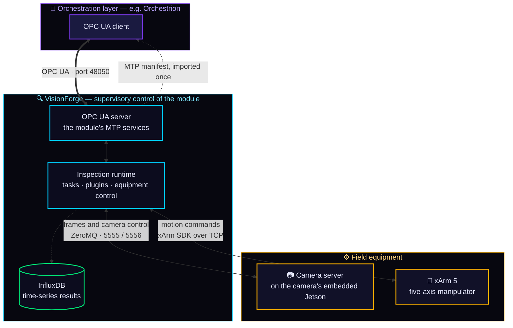

**Field equipment** at the bottom: the smart camera and the arm, each a device on the module's network.
**VisionForge** in the middle drives both, runs the inspections and exposes them. An **orchestration layer**
at the top imports the module's manifest once, then commands its services over OPC UA.

### From sensor to task

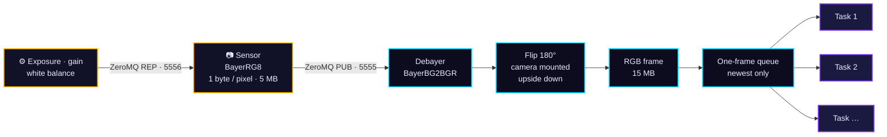

A colour sensor measures **one colour per pixel**, under a 2 × 2 mosaic of red, green and blue filters, so the
camera sends that mosaic — a third of the bytes of RGB — and VisionForge interpolates the two missing
channels at every pixel. Nothing is lost: the RGB image carries no information the mosaic did not.

The **one-frame, newest-only queue** is the decision that keeps the module live. A task slower than the camera
drops stale frames instead of falling behind, and because every task has its own thread, several inspect the
same camera at once.

<details>
<summary><b>🧵 Threads</b></summary>

<br>

All equipment I/O runs off the interface thread; Qt signals carry results back to it.

| Thread | Does |
|---|---|
| **Camera** | Receives, debayers and flips frames, and fans them out |
| **Arm** | Owns the xArm SDK connection, polls the pose at **10 Hz**, executes motion |
| **Gamepad** | Reads the controller at **100 Hz** and sends servo motion |
| **One per task** | Runs that task's vision work, fed by its own newest-only queue |

The OpenCV constant reads `BayerBG` for a `BayerRG8` sensor on purpose: OpenCV and camera vendors name the
mosaic from different corners of the tile.

</details>

<details>
<summary><b>🎮 Gamepad controls</b></summary>

<br>

| Control | Action |
|:---:|---|
| <kbd>Left stick</kbd> | Move in X and Y |
| <kbd>L1</kbd> &nbsp;/&nbsp; <kbd>R1</kbd> | Z down / up |
| <kbd>L2</kbd> &nbsp;/&nbsp; <kbd>R2</kbd> | Yaw one way / the other |
| <kbd>0</kbd> &nbsp;/&nbsp; <kbd>2</kbd> | Speed **+5 %** / **−5 %**, from 20 to 500 mm/s |
| <kbd>START</kbd> | Reset the arm: clear warnings and errors, re-enable motion |

Motion is sent in the arm's servo mode for smooth continuous control, and tapers off when the stick is
released. The operator can move the arm at any time, including while an inspection runs.

</details>

<p align="center"></p>

## 🔍 The inspection tasks

### 🔢 &nbsp;Seven-segment displays

<kbd>YOLO-OBB</kbd> <kbd>ByteTrack</kbd> <kbd>PARSeq</kbd> <kbd>InfluxDB</kbd> <kbd>visual servoing</kbd>

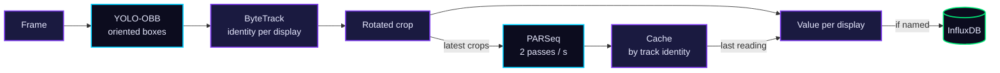

A fine-tuned **YOLO oriented-box** detector finds the displays at any angle, and **ByteTrack** gives each one a
stable identity across frames. Each box is rotated upright and cropped, then read by a **PARSeq**
scene-text-recognition model fine-tuned on the **twelve symbols** a display can show — `0–9`, `.` and `-`.
Classical OCR and other learned OCR methods were tried first; fine-tuning a scene-text model on the
laboratory's own displays proved best.

Detection runs on **every frame**, recognition a configurable number of times per second, and a cache keyed on
the track identity holds each display's last reading in between — which is what keeps the task live without
stalling on the recogniser. In **auto-balayage**, a 50 Hz visual-servo loop steers the arm to centre the
displays and approach until they fill about a fifth of the frame.

<details>
<summary>📸 &nbsp;<b>See it running</b></summary>
<br>
<p align="center">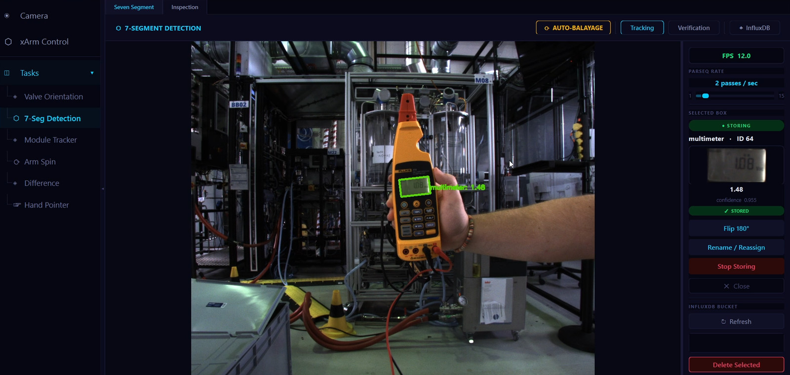</p>
</details>

### 🚰 &nbsp;Valve states

<kbd>AprilTag 25h9</kbd> <kbd>pose estimation</kbd> <kbd>30-sample vote</kbd> <kbd>up to 32 valves</kbd>

A 15 mm **AprilTag** is fixed to each valve handle, and its **open** and **closed** poses are taught once. From
then on the tag's orientation is classified by its **angular difference** from those two poses, and a
30-sample vote per valve keeps the state stable. To cover a whole bank, the arm runs a **detection scan**: it
moves to a captured pose and oscillates vertically by a set amplitude and speed, so every tag passes through
the view.

AprilTags win over ArUco here because they carry less payload per tag with stronger error correction, so they
resolve from fewer pixels — and a valve handle is small and often far away.

<details>
<summary>📸 &nbsp;<b>See it running</b></summary>
<br>
<p align="center">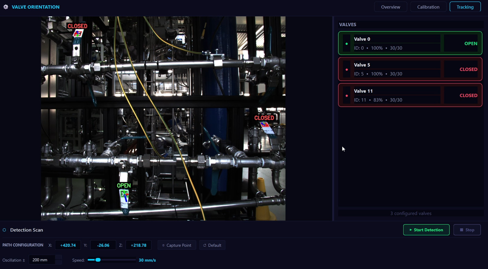</p>
</details>

### 🗺️ &nbsp;Module tracking

<kbd>ArUco 6X6_50</kbd> <kbd>solvePnP · 6-DoF</kbd> <kbd>metric map</kbd> <kbd>1 Hz history</kbd>

The PEAs of a modular plant are mobile, so the layout of the laboratory changes. A detector for every module
was tried first and abandoned — the modules differ too much in shape and appearance — and the simple
solution proved the more effective one.

Each module carries one **250 mm ArUco** marker. `solvePnP` recovers a full **six-degree-of-freedom pose**
from it, which is projected into the laboratory frame, and every module is drawn on a metric top-down map as
an **oriented footprint**, sized from its configured dimensions and turned by its heading. A snapshot is
logged once per second, browsable on a timeline, exportable to CSV and reloadable from InfluxDB.

<details>
<summary>📸 &nbsp;<b>See it running</b></summary>
<br>
<p align="center">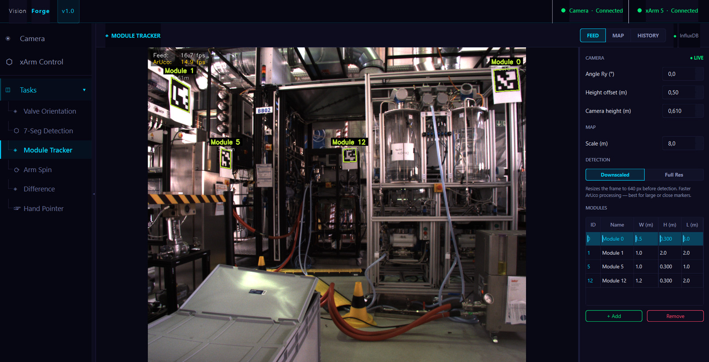</p>
<p align="center">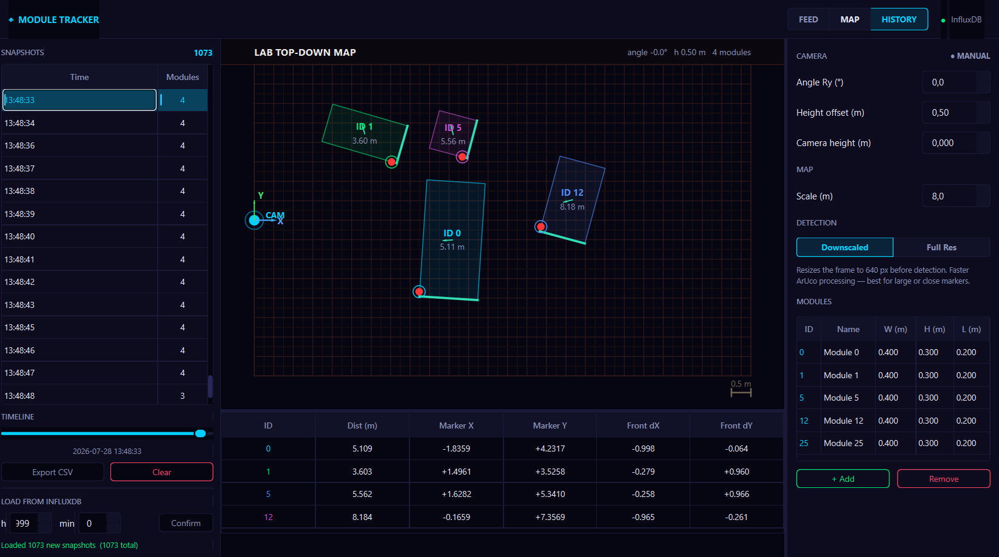</p>
</details>

### 💧 &nbsp;Leak detection

<kbd>semantic segmentation</kbd> <kbd>SAM 2.1 assisted annotation</kbd>

> [!WARNING]
> **Model trained and validated; integration into VisionForge in progress.** Not yet part of this repository.

A segmentation model fine-tuned on laboratory photographs. The data was annotated with an assisted
annotation tool, similar to Roboflow's but running locally on **SAM 2.1**: click the spill and the model
outlines it. Water is hard to segment because it has no appearance of its own — transparent and reflective, a
spill looks like whatever is under and around it — which is why training augments on scale, flip and colour.

<details>
<summary>📸 &nbsp;<b>See it running</b></summary>
<br>
<p align="center">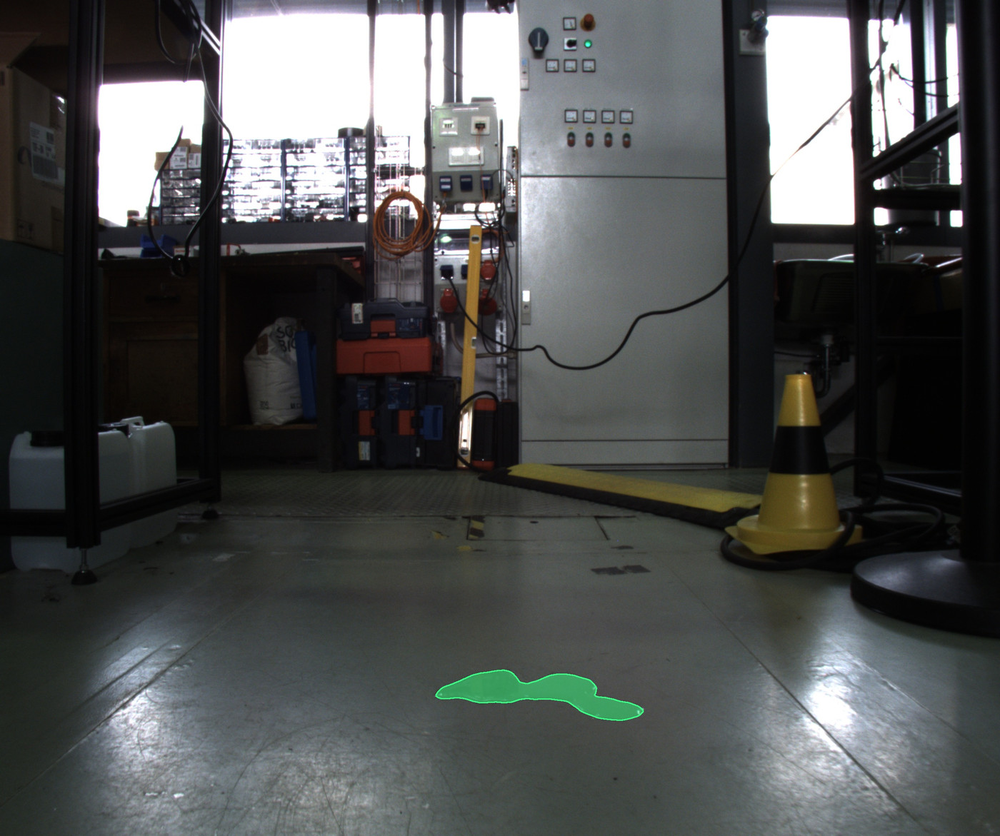</p>
<p align="center">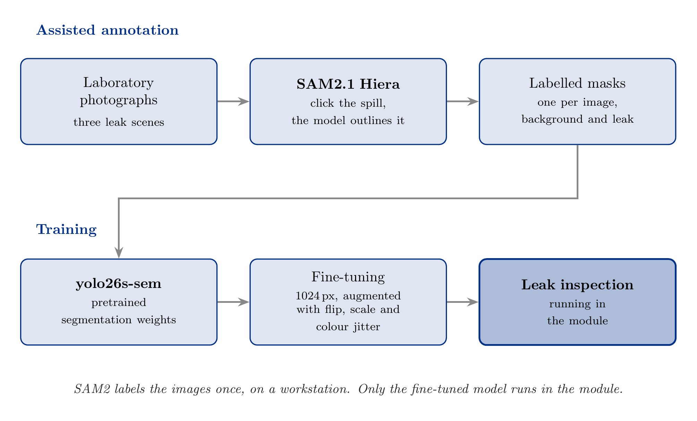</p>
</details>

### 📊 &nbsp;How accurate they are

<p align="center">
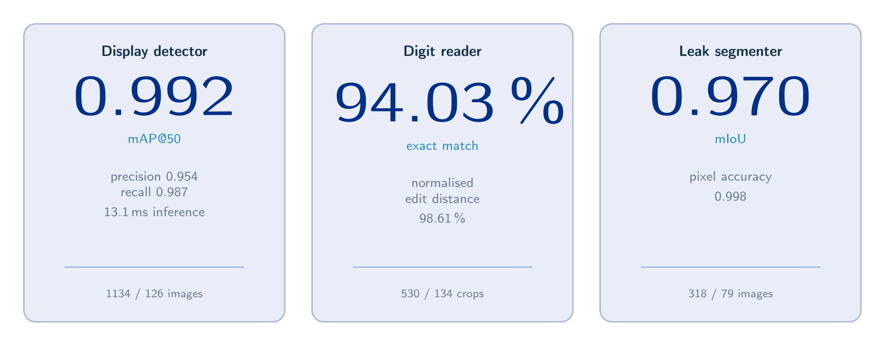
</p>

> [!TIP]
> **The held-out images come from different sessions, not a random split.** The detector's frames are sampled
> from recordings at three per second, so a random split would put near-identical frames on both sides and
> measure memory rather than generalisation. Split by day and conditions, these figures measure lighting,
> placement and scenes the models had not met.

<details>
<summary><b>📋 Full metrics</b></summary>

<br>

Every dataset was split before training and the held-out part never contributed a gradient. After each epoch
the model was measured on that part, and the checkpoint kept is the one that scored best there. Training and
validation losses fall together throughout, with no divergence.

| Model | Trained / held out | Result |
|---|---|---|
| **Display detector** · YOLO26-OBB | 1134 / 126 images | **mAP@50 0.992** · precision 0.954 · recall 0.987 · 13.1 ms inference |
| **Digit reader** · PARSeq | 530 / 134 crops | **94.03 % exact match** · normalised edit distance 98.61 % |
| **Leak segmenter** | 318 / 79 images | **mIoU 0.970** · pixel accuracy 0.998 |

</details>

<p align="center"></p>

## 🏭 A true PEA: MTP services over OPC UA

A module becomes a PEA once it exposes what it offers in a way any orchestration layer understands. In
VisionForge a task **declares** its service once, and [MTPPy](https://github.com/p2o-lab/MTPPy) turns that one
declaration into two artefacts: the **OPC UA server** that exposes it, and the **MTP manifest** that describes
it.

<p align="center">
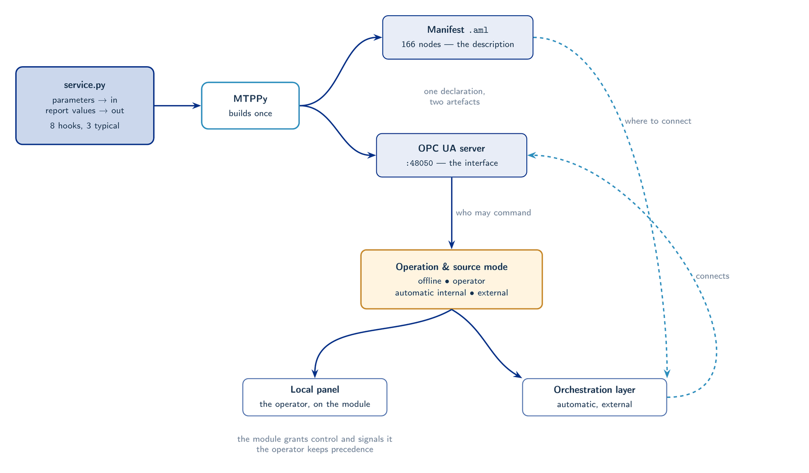
</p>

<div align="center">

**_The description cannot drift from the interface, because neither is written by hand._**<br>
<sub>The same pass that creates each OPC UA node writes its address into the manifest.</sub>

</div>

### The service lifecycle

The service state machine of VDI/VDE/NAMUR 2658-4 is implemented in full — **16 states, 10 commands**. The
module publishes `CommandEn`, recomputed on every change, so a client always knows which commands are legal.

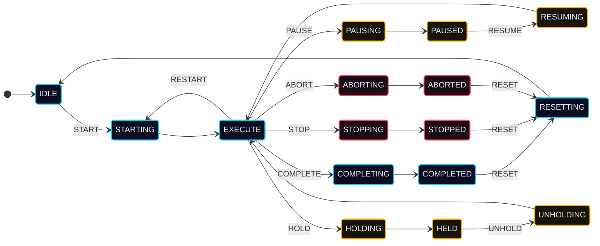

<sub>Simplified to transitions out of <code>EXECUTE</code>: <code>HOLD</code>, <code>STOP</code> and <code>ABORT</code> are also accepted from the other active states.</sub>

| | Pause | Hold |
|---|---|---|
| **Nature** | a planned break | an abnormal interruption |
| **Legal in** | `EXECUTE` only | `STARTING`, `EXECUTE`, `COMPLETING` — a fault does not wait for a convenient moment |
| **Back with** | `RESUME` | `UNHOLD` |

### Who may command a service

<div align="center">

| Mode | Who commands |
|:---|:---|
| ⚪&nbsp; **Offline** | Nobody — the start-up state, with `CommandEn` cleared |
| 👤&nbsp; **Operator** | A person, from the module's own interface |
| ⚙️&nbsp; **Automatic · internal** | A program inside the module |
| 🧭&nbsp; **Automatic · external** | An orchestration layer, over OPC UA |

</div>

Modes are **requested, never seized**: a client writes a request, and the module grants it and publishes that
it has. The operator keeps precedence and can take a service back at any moment, and a banner signals when an
orchestration layer holds it. With one camera serving every task, **one service runs at a time**, and leaving
the panel of a running service asks before sending `ABORT`.

### Writing a service

**The platform implements all sixteen states; a task only fills hooks.** It declares its parameters and report
values, and fills only the moments it cares about:

```python
from VisionForge.app.inspection.inspection_service import InspectionService

class SevenSegInspectionService(InspectionService):

    def __init__(self):
        super().__init__(tag_name='seven_segment_inspection',
                         tag_description='Seven-segment OCR inspection via YOLO-OBB + PARSeq')
        self.add_parameter('ana', 'confidence_threshold',
                           v_min=0.0, v_max=1.0, v_scl_min=0.0, v_scl_max=1.0)
        self.add_report_value('str', 'detections')

    def on_starting(self):                  # once, before EXECUTE: read the locked parameters
        self._threshold = float(self.get_param('confidence_threshold') or 0.5)

    def on_result(self, result):            # every frame: publish (lands only in EXECUTE)
        ...
        self.set_report('detections', f'{len(parts)}|' + '|'.join(parts))
```

| Hook | Called |
|---|---|
| `on_starting` | once, before `EXECUTE` — read the locked parameters |
| `on_result` | on every frame from the task's processor — publish report values |
| `on_completing` | once, before `COMPLETED` — write a final report |
| `on_pausing` · `on_holding` · `on_stopping` · `on_aborting` · `on_resetting` | when that command arrives — release what the task holds |

> [!NOTE]
> **The inspection itself never stops.** A task processes frames from the moment its panel opens. Starting a
> service opens the gate on **publication**: `set_report()` writes only while the service is in `EXECUTE`.

<details>
<summary><b>⚙️ How the states are split between MTPPy and the platform</b></summary>

<br>

MTPPy declares the sixteen state methods and owns the transition table; VisionForge implements what happens
*inside* each state. Because MTPPy runs each state's method on its own thread, every state takes one of three
shapes:

| Shape | States | What the method does |
|---|---|---|
| **Stable** | `IDLE` `EXECUTE` `COMPLETED` `PAUSED` `HELD` `STOPPED` `ABORTED` | waits until a command moves it |
| **Transient** | `STARTING` `COMPLETING` `PAUSING` `HOLDING` `STOPPING` `ABORTING` `RESETTING` | calls its hook, then advances by itself |
| **Pass-through** | `RESUMING` `UNHOLDING` | advances immediately |

The platform decides *what happens in* a state; MTPPy decides *which state comes next*.

</details>

<details>
<summary><b>📄 Generating the manifest</b></summary>

<br>

```bash
python artifacts/generate_mtp.py     # with VisionForge closed: it binds port 48050 briefly
```

Every task and plugin that declares a service is discovered and built into one PEA. The manifest is written
to `artifacts/visionforge_raw.aml`, MTPPy's own output, and `artifacts/visionforge.aml`, the same file with two
compatibility edits. It declares **166 OPC UA nodes** across the module's two services.

The manifest template is not part of the MTPPy pip package, so the script reads it from a clone of
[MTPPy](https://github.com/p2o-lab/MTPPy) placed next to the repository, at `../VDI_VDE_NAMUR_2658/MTPPy`.

</details>

<details>
<summary><b>✅ Conformance</b></summary>

<br>

The address space was browsed node by node with **UaExpert**, a client with no knowledge of the
implementation, and the tree structure and the **78 nodes of the seven-segment service** were checked by hand
— naming, data type and access rights — against the model of VDI/VDE/NAMUR 2658.

A whole service was then driven by writing node values by hand, exactly as an orchestration layer does
underneath: request automatic mode and the external source, write the parameter, write `4` to `CommandExt` —
and `StateCur` becomes `64`, `EXECUTE`, as the report value starts to fill.

See [`docs/mtp_inspection.md`](docs/mtp_inspection.md) for a UaExpert walkthrough, and
[`docs/MTP_STANDARD_AND_FRAMEWORK.md`](docs/MTP_STANDARD_AND_FRAMEWORK.md) for the standard itself.

</details>

<p align="center"></p>

## 🧩 Plugin SDK

A plugin is a folder dropped into `plugins/`. It is discovered at start-up and appears in the sidebar like a
built-in task; a broken plugin is skipped and logged, and never crashes the platform.

<div align="center">

<kbd> plugin.json </kbd> &nbsp;+&nbsp; <kbd> TaskProcessor </kbd> &nbsp;+&nbsp; <kbd> TaskPanel </kbd> &nbsp;=&nbsp; **a working task**<br><br>
<kbd> + InspectionService </kbd> &nbsp;=&nbsp; **an MTP service**, wired into the OPC UA server with no further code

</div>

```
plugins/my_plugin/
├── plugin.json     manifest
├── processor.py    the vision work        TaskProcessor
├── panel.py        the interface          TaskPanel
└── service.py      optional MTP service   InspectionService
```

```python
# processor.py — runs in its own thread
from VisionForge.app.plugin_sdk import TaskProcessor

class MyProcessor(TaskProcessor):
    def process_frame(self, frame_rgb, meta):
        # frame_rgb: H×W×3 uint8, always the newest frame
        # never touch Qt widgets here — emit instead
        self.display_ready.emit(qimage)
        self.result_ready.emit(my_data)
```

```python
# panel.py — runs on the interface thread
from VisionForge.app.plugin_sdk import TaskPanel
from processor import MyProcessor          # the plugin folder is on sys.path

class MyPanel(TaskPanel):
    def on_attach(self):
        # once, at load: build the UI and wire the processor
        self._processor = MyProcessor()

    def cleanup(self):
        super().cleanup()                   # always call super
```

<details>
<summary><b>🗂️ <code>plugin.json</code> and the class model</b></summary>

<br>

```json
{
  "name":           "my_plugin",
  "label":          "My Plugin",
  "icon":           "⬡",
  "version":        "1.0.0",
  "panel_module":   "panel",
  "panel_class":    "MyPanel",
  "service_module": "service",
  "service_class":  "MyInspectionService"
}
```

`service_module` and `service_class` are optional.

<p align="center">
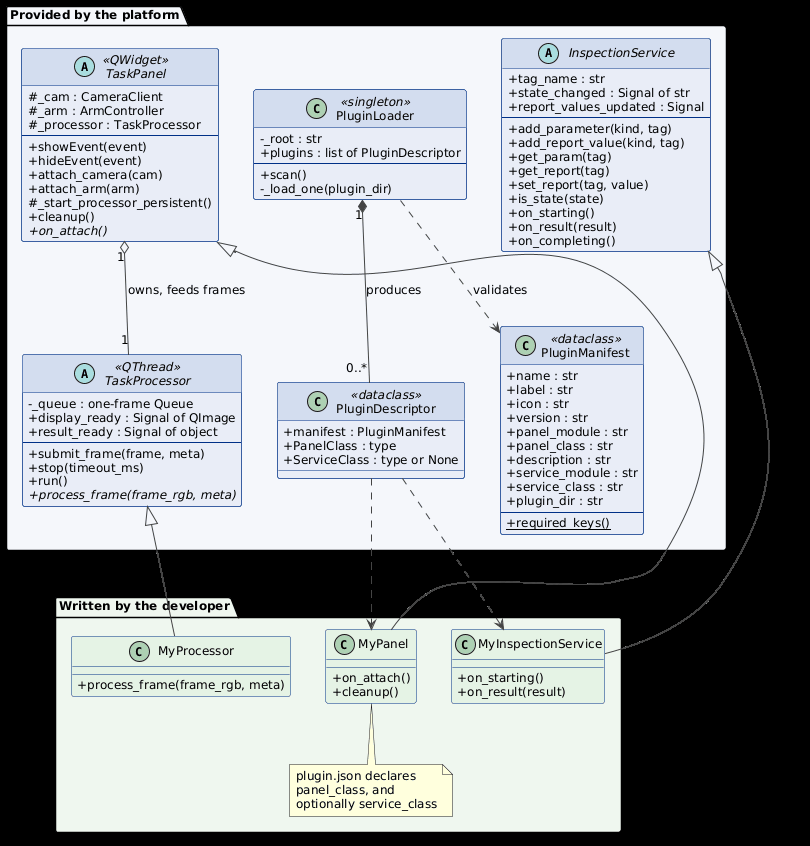
</p>

The base panel connects the camera to the processor when shown and disconnects it when hidden. `self._cam`
and `self._arm` may be `None` if that equipment was not connected, so check before use. Load model weights
once, in `__init__`, with `resolve_path(__file__, "weights/model.pt")`, so the path resolves from the plugin
folder wherever the platform is launched.

</details>

<details>
<summary><b>🧪 Testing a plugin before installing it</b></summary>

<br>

```bash
# from the folder above the repository
python -m VisionForge.app.plugin_sdk.dev_runner VisionForge/plugins/my_plugin \
       --camera 10.6.51.140 --arm 10.6.51.141 --opc-port 48050
```

The runner opens the plugin on its own, with an equipment monitor, the camera configuration, and — if the
plugin declares a service — an inspection window with the full command set and a live OPC UA server for
UaExpert or an orchestration layer.

```bash
python tools/build_sdk_zip.py        # → dist/visionforge-sdk-1.0.0.zip
```

The SDK archive mirrors the package layout, so `from VisionForge.app.plugin_sdk import TaskPanel` resolves the
same way during development and after installation. See [`docs/plugin_sdk.md`](docs/plugin_sdk.md).

</details>

### Bundled plugins

| | Plugin | What it does |
|:---:|---|---|
| 🔬 | **`example_difference`** | Reference plugin: frame difference thresholded into a motion percentage, **with an MTP service** |
| 🔄 | **`arm_spin`** | Tutorial: oscillates the arm ±60 mm in Y at 0.3 Hz in servo mode, on its own 20 Hz thread |
| ✋ | **`hand_pointer`** | Gesture control with MediaPipe: point and the arm follows the finger, make a fist and it holds |

<p align="center"></p>

## 📐 Standards implemented

| Standard | What is implemented here |
|---|---|
| **VDI/VDE/NAMUR 2658-1** | The MTP manifest, generated from the module's own service declarations |
| **VDI/VDE/NAMUR 2658-3** | Data assemblies for parameters and values: engineering units, limits and scale ranges |
| **VDI/VDE/NAMUR 2658-4** | The service model: 16 states, 10 commands, `CommandEn`, procedures, parameters and report values, and the operation-mode and source-mode handshakes |
| **VDI/VDE/NAMUR 2658-5.1** | The OPC UA runtime binding of all of the above |

## 🛠️ Built with

<div align="center">


<br>


</div>

<details>
<summary><b>📁 Project structure</b></summary>

<br>

```
VisionForge/
├── main.py                        entry point
├── app/
│   ├── splash.py                  start-up: loads the models, scans the plugins
│   ├── connection_dialog.py       camera IP · arm IP · OPC UA port
│   ├── main_window.py             shell, sidebar, plugin and service wiring
│   ├── core/
│   │   ├── camera_client.py       ZeroMQ client: frames in, parameters out
│   │   ├── arm_controller.py      xArm 5 control
│   │   ├── gamepad_controller.py  manual control
│   │   └── media_manager.py       snapshots and recordings
│   ├── inspection/                ── the MTP side ──
│   │   ├── inspection_service.py  InspectionService: the 16 states and the 8 hooks
│   │   ├── inspection_module.py   the PEA: owns the OPC UA server, one active service
│   │   ├── inspection_tab.py      the inspection panel: state, commands, values
│   │   └── service_aware_panel.py adds the inspection tab to a task panel
│   ├── plugin_sdk/                ── the SDK ──
│   │   ├── base.py                TaskPanel · TaskProcessor
│   │   ├── manifest.py            plugin.json
│   │   ├── loader.py              discovery
│   │   ├── utils.py               resolve_path · save_frame
│   │   └── dev_runner.py          test a plugin on its own
│   ├── tasks/
│   │   ├── seven_segment/         YOLO-OBB · ByteTrack · PARSeq  (+ service.py)
│   │   ├── valve_orientation/     AprilTag pose and state voting
│   │   └── module_tracker/        ArUco 6-DoF pose and metric map
│   ├── widgets/                   shared interface components
│   └── styles/                    theme
├── plugins/
│   ├── example_difference/        reference plugin  (+ service.py)
│   ├── arm_spin/                  tutorial
│   └── hand_pointer/              gesture control
├── artifacts/generate_mtp.py      MTP manifest generation
├── tools/build_sdk_zip.py         SDK packaging
└── docs/                          plugin_sdk.md · mtp_inspection.md · MTP_STANDARD_AND_FRAMEWORK.md
```

</details>

<p align="center"></p>

## 🔗 Related

<table>
<tr>
<td width="50%" valign="top">

### 🧭 [Orchestrion](https://github.com/marwendh/Orchestrion)
The open Process Orchestration Layer built alongside VisionForge. It imports the module's manifest, commands
its services over OPC UA, and runs ISA-88 recipes across it and other PEAs.

</td>
<td width="50%" valign="top">

### 🐍 [MTPPy](https://github.com/p2o-lab/MTPPy)
The P2O-Lab's open-source Python library for MTP modules, on which every VisionForge service is built.

</td>
</tr>
</table>

<br>

<div align="center">

<sub>Developed at the <b>Chair of Process Control Systems · P2O-Lab · TU Dresden</b></sub><br>
<sub>as part of a graduation project in Industrial Computing and Automation at <b>INSAT</b>, University of Carthage,</sub><br>
<sub>within the <b>DAAD-KOSPIE</b> programme · released under the <a href="LICENSE">MIT License</a></sub>

</div>
